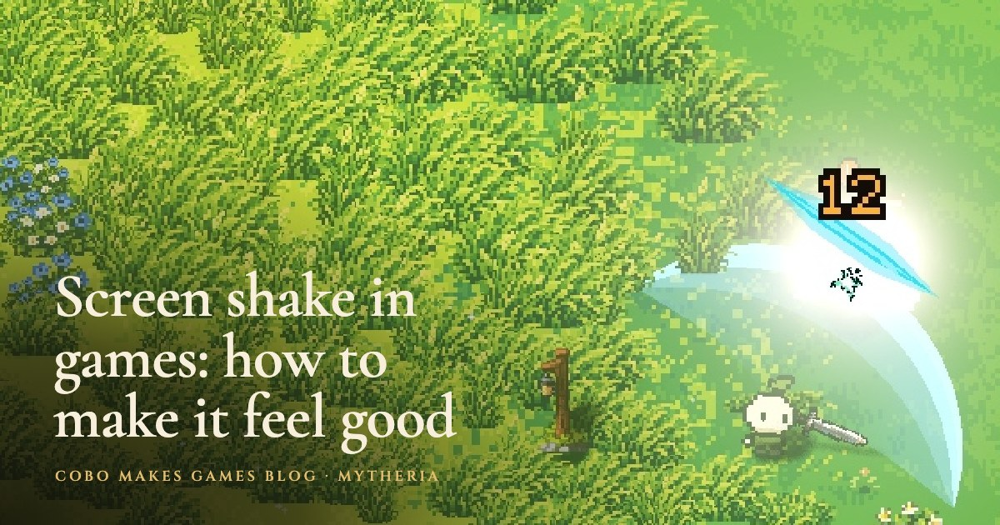
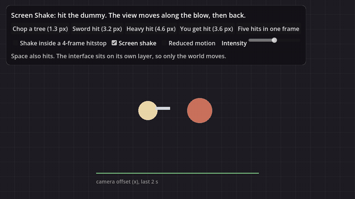

# Screen Shake for Godot 4



Screen shake that makes hits feel heavy without making the game look broken or making anyone sick. The view moves along the line of the blow and back, eases in over a frame instead of jumping, and only the strongest hit of a frame moves it. A new shake picks up from wherever the view already is, and nothing ever goes past a hard limit. It moves the picture only, never the camera's position, your aim or your physics.

It's the camera shake from [Mytheria](https://cobomakesgames.com/mytheria/), our pixel-art co-op game. Why each rule is there, with the old and new shake curves to compare, is in [screen shake in games: how to make it feel good](https://cobomakesgames.com/blog/screen-shake-in-games/).



## Why not random noise?

Most screen shake examples add random noise to the camera every frame for a while. That rattles on two axes at once, starts at full strength on the frame of the hit (the whole picture teleports, which reads as a glitch), and a pile of hits adds up into something wild. This add-on fixes each of those:

- You give it the direction of the blow, and the view moves away from it and back, which shows which way the hit went and matches the knockback.
- Every shake starts at zero offset on the frame you request it and reaches its peak just after.
- Five enemies hit by one sweep request five shakes; only the strongest is used.
- A second hit while the view is still moving starts from the current offset instead of snapping back to the middle.
- `max_offset` caps the result whatever is requested.
- Pass a hold time and the shake jolts, wobbles about one and a half times while the fighters are frozen, and settles 60 ms after the freeze ends, so your eyes don't lose the fight. Pairs with [Hitstop](https://github.com/Cobo-Makes-Games/godot-hitstop).
- The offset is a function of time, so 30 and 144 frames a second show the same shake.

## Install

Copy `addons/screen_shake` into your project's `addons` folder and enable **Screen Shake** under Project Settings > Plugins. Godot 4.3 and later (tested on 4.6 and 4.7).

## Use

Add a `ScreenShake` node as a child of your `Camera2D` or `Camera3D` (or set its `camera` property), then request shakes:

```gdscript
@onready var shake: ScreenShake = $Camera2D/ScreenShake

func _on_enemy_hit(hit_direction: Vector2, damage: int) -> void:
	shake.add(3.2, hit_direction)                     # a recoil, 3.2 px at its peak
	# or, with a 4-frame hitstop:
	shake.add(3.2, hit_direction, 4.0 / 60.0)
```

`strength` is the peak offset: pixels for `Camera2D` (it sets `offset`), metres for `Camera3D` (it sets `h_offset` and `v_offset`). Requests at or above `heavy_strength` get a heavier recoil with one smaller return swing.

What Mytheria uses, as a starting point (at 1280x800):

| Event | Strength |
|---|---|
| Chopping a tree, hitting a rock | 1.3 px, light |
| A ranged hit | 1.2 px |
| A sword hit, inside a 4-frame hitstop | 3.2 px |
| A heavy weapon | 4.6 px |
| Getting hit | 3.6 px, the strongest everyday shake, so you always notice it |

### Settings for players

Give `enabled` a Screen shake switch in your settings and `reduced_motion` your Reduced motion setting; either one keeps the camera perfectly still. `intensity` multiplies every request for a strength slider.

### Keeping the aim steady

Camera2D's offset also moves `get_global_mouse_position()`. Use `shake.unshaken_mouse_position()` for aiming, so the shake never moves where the player points.

### Other settings

`max_offset` (6), `heavy_strength` (2.2), `settle_seconds` (0.06) and `ignore_time_scale` (true: the shake keeps real speed during slow motion or a global freeze). `shake_started(strength, direction)` fires for each accepted shake, `is_shaking()` and `offset` tell you where it is, and `advance(dt)` lets you drive it from your own clock.

## Demo and tests

Run the project in this repository: hit the dummy with different strengths, try five hits in one frame, the hitstop mode and the switches, and watch the offset graph. The checks run with:

```
godot --headless --path . --script tests/test_screen_shake.gd
```

## License

MIT, by [Cobo Makes Games](https://cobomakesgames.com). If it helps your game, we'd love to hear about it.
